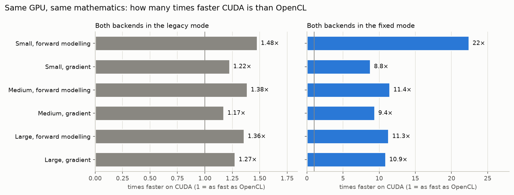
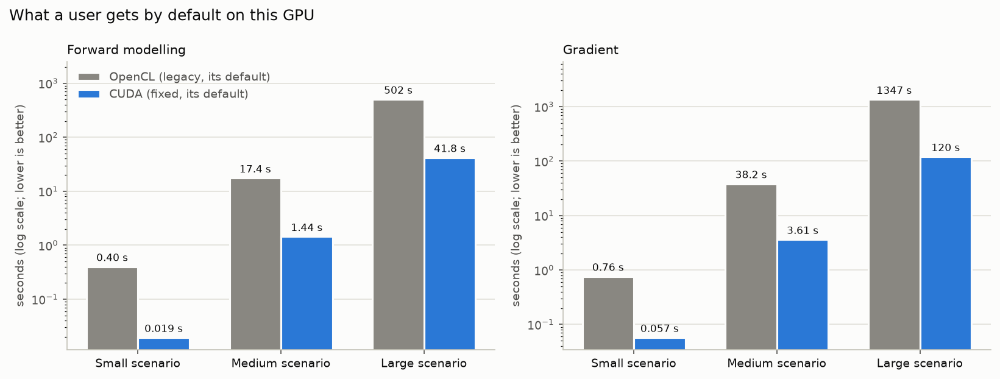
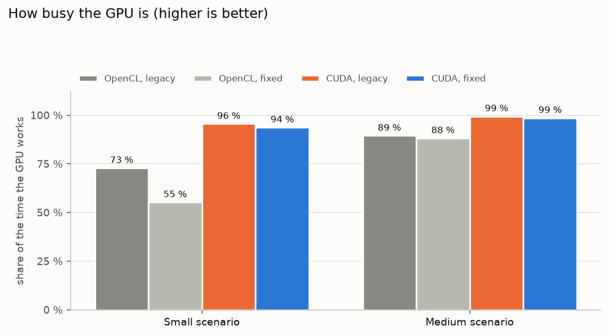
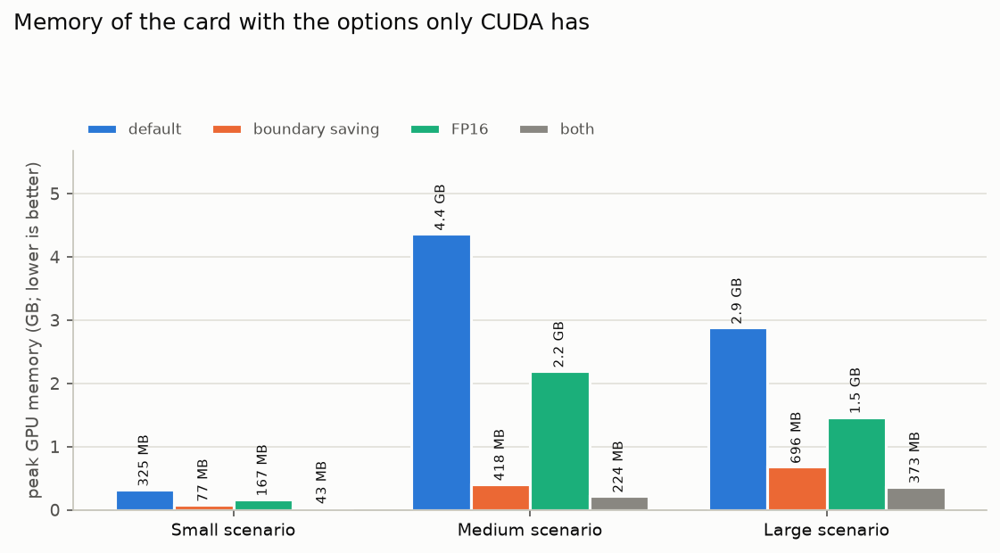

# CUDA against OpenCL on the project's graphics card

PyFWI simulates seismic waves and uses them to image the subsurface. It does its heavy computing on a
graphics card (a GPU), which it can drive in two ways: through **OpenCL**, the way the original PyFWI was
written, or through **CUDA**, the way this fork added. This document answers three questions for someone who
knows neither GPUs nor the code: on the card of the project, a GeForce RTX 3060 with 12 GB of memory, **how
much faster is CUDA, why, and what does it cost?** Every number comes from measurements stored in the
repository (see [How to reproduce](#how-to-reproduce)), and a test checks each one against them.

## The short answer

- **Doing exactly the same calculation, with the numerical corrections of the fork (the `fixed` mode), CUDA is
  8.8× to 22× faster than OpenCL** on this card: a gradient of the medium test case takes 3.61 s instead of
  33.8 s.
- **What a user gets by default**, with nothing set, is 10.6× to 21× faster with CUDA.
- The gain does not come from CUDA being a faster language: running the very same program text, CUDA is only
  1.17× to 1.48× faster. It comes from **programs rewritten for the card** with CUDA's tools: fewer orders
  sent from the computer to the card, a card that works almost all the time instead of waiting, and the
  card's own memory used to keep intermediate results.
- **Nothing else changes**: the same code, and, in the same numeric mode, the same results up to the last
  digits a computer rounds. (By default the results differ: CUDA corrects the numerical errors of the
  original PyFWI, which OpenCL keeps; see "numeric mode" below.)
- **What it costs**: an NVIDIA card, a larger installation (the CUDA libraries), and some of the card's
  memory.

## A few words first

- **GPU, graphics card**: a processor with thousands of small cores, very fast when the same operation is
  repeated over millions of numbers, as in a wave simulation. The computer's main processor (the CPU) gives it
  orders and data.
- **OpenCL and CUDA**: two ways for a program to give orders to a GPU. OpenCL works on cards of every brand;
  CUDA only on NVIDIA cards, with more tools. PyFWI calls each one a **backend**.
- **Kernel**: a small program that the GPU runs on every point of the model at once, for example "move the
  wave forward by one time step".
- **Forward modelling** and **gradient**: the two calculations an inversion repeats. The forward modelling
  simulates the waves of every seismic source through a model of the subsurface, one small time step after
  another (thousands of steps); the gradient runs a second simulation backwards in time to find how to correct
  the model. A gradient costs about two to three forward modellings.
- **Scenarios**: three test cases taken from the analysis that started the project. *Small*: a 100 × 100 grid,
  4 sources (an example of the documentation). *Medium*: 400 × 400, 8 sources. *Large*: 600 × 750, 50 sources.
- **Numeric mode**: the original PyFWI has small numerical errors. The `legacy` mode keeps them (the results
  of the original, bit for bit); the `fixed` mode corrects them (the [user guide](user-guide.md) lists them).
  OpenCL uses `legacy` by default, CUDA `fixed`; either backend runs either mode.

## Same calculation, two backends

Each scenario was run on the same card, in one session, on both backends and in both numeric modes: one
forward modelling and one gradient, five times after a warm-up, keeping the middle value.



| Scenario | | OpenCL `legacy` | OpenCL `fixed` | CUDA `legacy` | CUDA `fixed` |
| --- | --- | --- | --- | --- | --- |
| Small | forward modelling | 0.40 s | 0.44 s | 0.27 s | 0.019 s |
| | gradient | 0.76 s | 0.50 s | 0.62 s | 0.057 s |
| Medium | forward modelling | 17.4 s | 16.5 s | 12.6 s | 1.44 s |
| | gradient | 38.2 s | 33.8 s | 32.6 s | 3.61 s |
| Large | forward modelling | 502 s | 472 s | 370 s | 41.8 s |
| | gradient | 1347 s | 1306 s | 1057 s | 120 s |

(The medium and large scenarios run 2 and 1 of their sources and scale the time to all of them.)

- **In the `fixed` mode**, CUDA is 22× faster for the forward modelling of the small scenario and 8.8× for
  its gradient; 11.4× and 9.4× in the medium one; 11.3× and 10.9× in the large one.
- **In the `legacy` mode**, both backends run the same kernels, the files of the original PyFWI, compiled by
  NVIDIA for OpenCL and for CUDA: CUDA is only 1.17× to 1.48× faster (1.48× and 1.22× small, 1.38× and 1.17×
  medium, 1.36× and 1.27× large). The `legacy` mode keeps the original kernels on purpose, so that its
  results stay those of the original.

## What a user gets by default

Without any setting, OpenCL runs in the `legacy` mode and CUDA in the `fixed` mode:



CUDA is 21× faster for the forward modelling of the small scenario and 13.3× for its gradient, 12.1× and
10.6× in the medium one, 12.0× and 11.2× in the large one. A gradient of the large scenario, 50 sources,
takes 120 s instead of 1347 s.

## Where the difference comes from

The `legacy` comparison shows that changing the backend alone gains little. The gain of the `fixed` mode comes
from kernels written again for the card, one improvement at a time, each measured (Phase 3 of the
[roadmap](execution-roadmap.md); the [overview](overview.md) shows the steps). In plain words:

**1. Fewer orders from the computer.** On OpenCL, the computer sends the card 4.1 commands for every time
step of a forward modelling and 6.3 commands for every step of a gradient (5.0 commands in the `fixed` mode,
which injects the source at every step), thousands of times per simulation; each order costs the computer
some time. On CUDA, the work of a time step was merged into fewer kernels, and the orders of many time steps
are recorded once and replayed by the card from a single order (a *CUDA graph*). One time step of one
source takes 0.095 ms on OpenCL and 0.005 ms on CUDA in the small scenario.

**2. A card that does not wait.** When the computer is slower to give orders than the card is to carry them
out, the card waits. The share of the time the card works:



On the small scenario the card works 73 % of the time on OpenCL (`legacy`; 55 % in the `fixed` mode: its
kernels finish sooner, so the card waits longer for the next order) against 94 % to 96 % on CUDA; on the medium one 89 % against 99 %. On OpenCL this is
the time of its kernels over the whole run; on CUDA the time during which a kernel or a copy runs, from a
timeline of the card (Nsight Systems).

**3. The card's memory used for intermediate results.** The gradient needs snapshots of the forward simulation
(*checkpoints*). OpenCL copies them to the computer's memory as they are made and back when they are needed:
1.0 copies per time step of a forward modelling and 1.7 copies per step of a gradient, through the connection
between the computer and the card. CUDA keeps them in the card's memory when they fit, without any copy: with
them, the memory the card uses peaks at 325 MB in the small scenario, 4.4 GB in the medium one and 2.9 GB in
the large one (for the sources run at once: 4, 2 and 1). When they do not fit, the rest goes to the computer's memory, as on OpenCL.

**4. Kernels that read less memory.** The calculation of a time step is limited by how fast the card reads
its memory. The kernels written for CUDA read the damping of the model borders only near the borders, use
single-precision numbers throughout (the card computes double precision 64 times slower) and run several
sources at once.

**5. Options only CUDA has.** Release 0.4.0 added options for the CUDA backend: *boundary saving* stores a
thin band around the model instead of whole snapshots; *FP16* stores the waves with half as many digits.



Boundary saving needs 4.2× (small), 10.7× (medium) and 4.2× (large) less memory: 77 MB, 418 MB and 696 MB.
FP16 halves it (1.95× to 1.99× less) and is faster, but is meant for simulations and gradients, not for
complete inversions. Both together: 7.6×, 20.0× and 7.9× less, 43 MB, 224 MB and 373 MB. The sources can also
be shared between several NVIDIA cards, and PyTorch can hand its data to PyFWI on the card.

## What does not change

- **The results.** In the same numeric mode, the two backends give the same numbers up to the rounding of the
  last digits (about one millionth of a seismogram; the [parity report](reports/parity-0.4.0.md) gives every
  case). After a complete inversion, where these tiny differences grow from iteration to iteration, the
  models of the two backends differ by at most 1.7 % of what the inversion recovers, and their measures of
  quality (how close to the true model, how well the change between two surveys is found) agree within
  0.008 ([geophysical validation](reports/geophysical-validation-0.4.0.dev0.md), awaiting the review of a
  geophysicist).
- **The code.** A script written for the original PyFWI runs unchanged; the backend is chosen outside the
  code, by the installation or by the `PYFWI_BACKEND` setting.
- **OpenCL is still there**, and still the right choice when the computer has no NVIDIA card (an AMD or Intel
  card, or no card at all: OpenCL also runs on the main processor), when the CUDA libraries cannot be
  installed, or when the exact results of the original PyFWI are needed (its `legacy` mode).

## What it costs

- **An NVIDIA card** and its driver (version 580 or newer for CUDA 13, 525 or newer for CUDA 12).
- **A larger installation**: `pip install ".[cuda13]"` adds CuPy and the CUDA libraries, downloaded from PyPI;
  no other installation is needed.
- **Some of the card's memory** for the snapshots of the simulation, at most 80 % of what is free; the options
  above reduce it.
- **Results of the `fixed` mode**, which differ from those of the original PyFWI where the original was wrong.
  Who needs the original results can run CUDA in the `legacy` mode (`PYFWI_NUMERICS=legacy`), and keeps the
  1.17× to 1.48× above.

## How to reproduce

On a machine with an NVIDIA card and the development environment (`tools/setup_envs.sh dev`):

```bash
../envs/dev/bin/python tools/cuda_vs_opencl.py --measure   # the session (about 25 minutes), then the figures
../envs/dev/bin/python tools/cuda_vs_opencl.py             # the figures again, from the stored results
../envs/dev/bin/python -m pytest test/test_cuda_vs_opencl.py
```

The session writes `bench/cuda-vs-opencl/`: one benchmark file per backend and numeric mode
(`tools/benchmark.py`) and the share of the time the card works (`tools/opencl_profile.py` for OpenCL,
`tools/timeline.py` for CUDA). The memory of the options comes from the runs of release 0.4.0
(`bench/release-0.4.0/`, [benchmark report](reports/benchmark-0.4.0.md)). The measurements were made on
Oct 27, 2026, on the development machine: GeForce RTX 3060 12 GB, NVIDIA driver 580.95.05, Ryzen 7 5700X;
the card also drives the desktop, which adds small random pauses.
