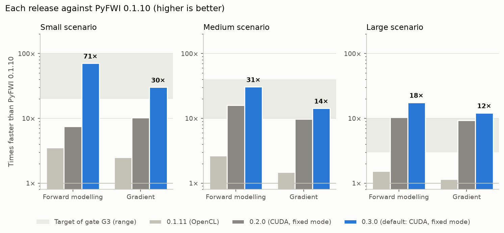
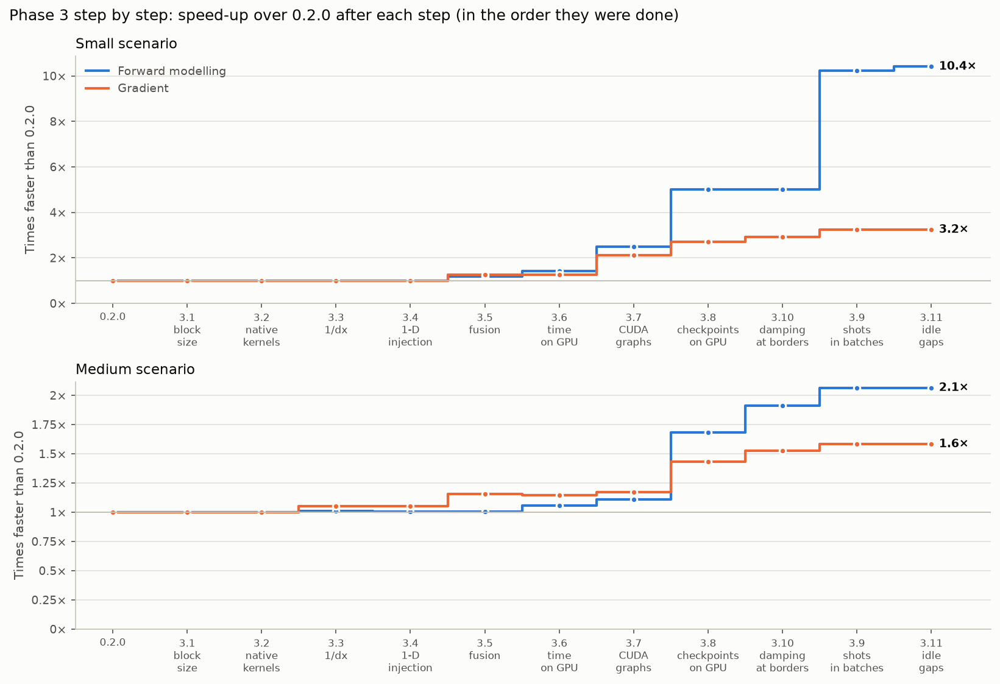
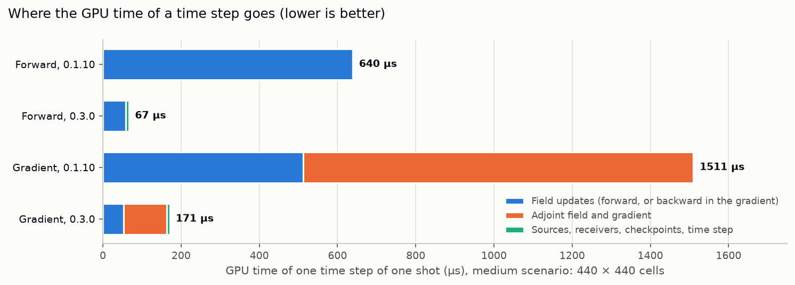
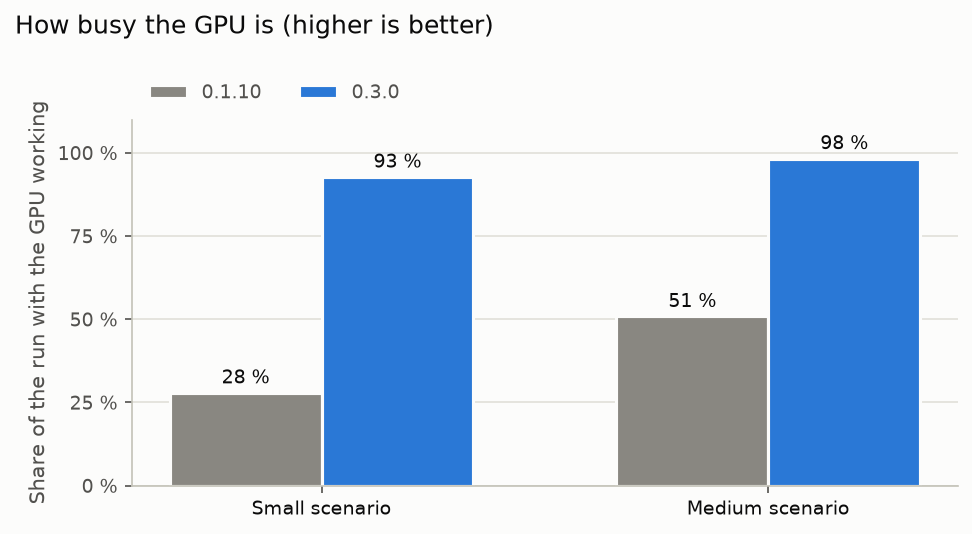
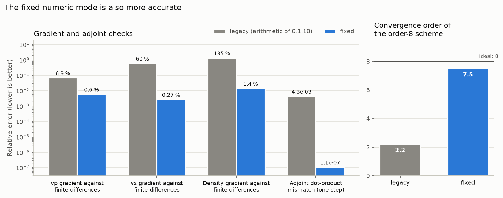

# pyfwi-cuda at release 0.3.0: what changed and what it gained

Oct 26, 2026 · an overview for readers new to the project. The details are in the
[execution roadmap](execution-roadmap.md), the [gate documents](gates/) and the [reports](reports/); every
number here comes from them or from the result files in `bench/`, and the figures are drawn from those
files by `tools/plot_overview.py`.

## In one paragraph

PyFWI does **full-waveform inversion** (FWI): it simulates seismic waves travelling through a model of the
subsurface (the *forward modelling*), compares the simulated recordings with the real ones, and computes
the *gradient* of that mismatch with respect to the model, which tells how to change the model to reduce
it. An inversion repeats forward modelling and gradient for every shot at every iteration, so their speed
decides how large a problem one can afford. This fork of PyFWI 0.1.10 makes them fast on NVIDIA GeForce
RTX cards **without changing the public API**: a script written for 0.1.10 runs unchanged. In release
0.3.0, on an RTX 3060, the forward modelling is **18 to 71 times** faster than in 0.1.10 and the gradient
**12 to 30 times**, and the default numeric mode of the GPU path also corrects numerical errors of 0.1.10.

## At a glance

Default configuration of 0.3.0 (CUDA backend, `fixed` numeric mode) against PyFWI 0.1.10, both measured
in the same session on a GeForce RTX 3060 12 GB ([benchmark report](reports/benchmark-0.3.0.md)):

| Scenario | Forward modelling, 0.1.10 → 0.3.0 | Speed-up | Gradient, 0.1.10 → 0.3.0 | Speed-up |
| --- | --- | --- | --- | --- |
| Small (100 × 100 cells, 4 shots) | 1.53 s → 0.022 s | **71×** | 1.99 s → 0.066 s | **30×** |
| Medium (400 × 400 cells, 8 shots) | 51.1 s → 1.66 s | **31×** | 59.8 s → 4.17 s | **14×** |
| Large (600 × 750 cells, 50 shots) | 852 s → 48.4 s | **17.6×** | 1,699 s → 140 s | **12.2×** |

To get it, install the fork with a CUDA extra (`pip install ".[cuda13]"`, or `[cuda12]` for older NVIDIA
drivers) and run the same script: the default backend, `auto`, picks the GPU. Without the extra, PyFWI
runs its OpenCL engine and gives exactly the results of 0.1.10. See the README, "Choosing the backend".

## How the numbers are measured

`tools/benchmark.py` runs three scenarios taken from the analysis of the project, each once to warm up
and then 5 times (the median is reported), timing one forward modelling and one gradient:

| Scenario | Model (cells) | With absorbing layer | Shots | Time steps per shot | Note |
| --- | --- | --- | --- | --- | --- |
| Small | 100 × 100 | 140 × 140 | 4 | 1,050 | the example of the documentation |
| Medium | 400 × 400 | 440 × 440 | 8 | 3,000 | 2 shots run, times scaled to 8 |
| Large | 600 × 750 | 640 × 790 | 50 | 6,000 | 1 shot run, times scaled to 50 |

A **speed-up** is the time of 0.1.10 divided by the time of the release (10× = ten times faster). The GPU
of the development machine also draws the desktop and changes its clocks with temperature, so runs are
compared within the same session wherever possible.

## 1. Each release against 0.1.10



| Release | What it brought | Small fwd / grad | Medium fwd / grad | Large fwd / grad |
| --- | --- | --- | --- | --- |
| 0.1.11 (OpenCL) | Phase 1: less host overhead in the OpenCL engine | 3.5× / 2.5× | 2.6× / 1.5× | 1.5× / 1.1× |
| 0.2.0 (CUDA, `fixed`) | Phase 2: CUDA backend, FP32-only arithmetic | 7.5× / 10.2× | 15.8× / 9.7× | 10.4× / 9.3× |
| 0.3.0 (default) | Phase 3: kernels written for CUDA | 71× / 30× | 31× / 14× | 17.6× / 12.2× |

The shaded bands are the targets that gate G3 set from the analysis (small 20 to 100×, medium 10 to 40×,
large 3 to 10×): all six are met, the large scenario above its band. 0.1.11 and 0.2.0 are compared with the
baseline of 0.1.10 recorded at the start of the project; 0.3.0 with a run of 0.1.10 in its own session.

## 2. Where 0.1.10 lost its time

A GPU program has two sides. The **host** (the CPU, here running Python) decides what to do and asks the
GPU to run small programs, the **kernels**, one *launch* at a time; each launch costs the host a few
microseconds. The **GPU** runs a kernel on every cell of the grid at once; a stencil kernel like those of
PyFWI is limited by how fast it can read and write GPU memory (360 GB/s on the RTX 3060). Copies between
host and GPU memory go through the PCIe bus, much slower, and a copy the host waits for stops everything.

The profile of 0.1.10 ([baseline report](reports/benchmark-baseline-0.1.10.md)) found both sides slow:

- **The GPU waited for the host** most of the time: it worked 28 % of the run in the small scenario and
  51 % in the medium one. Every time step, Python launched 4 to 7 kernels (setting their arguments again
  each time) and made blocking copies (2.7 per step).
- **The kernels themselves were slow**: `update_tauz` moved about 35 GB/s, a tenth of what the memory
  allows, partly because constants written without the `f` suffix made part of the arithmetic double
  precision, which GeForce cards run 64 times slower than single precision.

Each phase of the roadmap attacked one side:

1. **Phase 1 (0.1.11)**, on the host, still OpenCL: kernels retrieved once and their arguments set once,
   copies that do not block, the residual kept on the GPU.
2. **Phase 2 (0.2.0)**: the CUDA backend, first with the same kernel files as OpenCL (the *parity*
   backend), and the `fixed` numeric mode, which computes in single precision only and corrects the
   numerical bugs found on the way (section 6).
3. **Phase 3 (0.3.0)**: kernels written for CUDA, then one optimisation per step, each measured before and
   after (section 3).

## 3. Phase 3 step by step



Each step was one commit, measured before and after in the same session; the curves multiply those
ratios, so they show what each idea added (the small scenario was measured with two decimals until step
3.10, hence the coarse steps). Steps 3.1 to 3.4 prepared the ground without changing the time; the big
gains came from removing work the host did at every time step.

| Step | Idea, in plain words | Small fwd / grad | Medium fwd / grad |
| --- | --- | --- | --- |
| 3.1 | Choose the shape of the thread blocks per GPU (an automatic tuning was tried and rejected: slower) | — | — |
| 3.2 | Kernels written for CUDA, giving the same bits as the OpenCL ones; the order of the finite differences as a template | — | — |
| 3.3 | Multiply by `1/dx` instead of dividing by `dx` (26 divisions per cell and step saved) | — | 1.01× / 1.05× |
| 3.4 | Sources and receivers handled by one thread per receiver instead of a kernel over the whole grid | — | 0.99× / — |
| 3.5 | **Fusion**: one kernel does the work of two (5 launches per forward step become 3, 8 per gradient step 5) | 1.18× / 1.27× | 1.00× / 1.10× |
| 3.6 | The time step kept on the GPU, so that every launch of a step has the same arguments | 1.21× / 1.00× | 1.05× / 0.99× |
| 3.7 | **CUDA graphs**: up to 50 steps recorded once and replayed with one call from the host | 1.75× / 1.67× | 1.05× / 1.02× |
| 3.8 | **Checkpoints on the GPU**: the snapshots of the wavefield that the gradient needs stay in GPU memory instead of crossing PCIe | 2.00× / 1.29× | 1.52× / 1.22× |
| 3.10 | The damping of the absorbing layer read only near the borders (two reads per cell saved inside) | 1.00× / 1.08× | 1.14× / 1.07× |
| 3.9 | **Shots in batches**: the shots of a small grid run in the same launches, and the checkpoints of a batch are copied in one launch | 2.04× / 1.11× | 1.08× / 1.04× |
| 3.11 | The idle gaps of the timeline removed (graphs kept from run to run, seismograms read at once) | 1.02× / — | — |
| | **All of Phase 3** | **10.4× / 3.2×** | **2.1× / 1.6×** |

The small scenario gained most because its time was mostly host overhead: its grid is so small that the
GPU finishes a kernel in a few microseconds, about the cost of launching it. The medium and large
scenarios were already limited by the GPU; they gained from fewer kernels, fewer memory reads and the
checkpoints kept on the GPU. Step 3.10 was done before 3.9: the order did not matter for these
independent steps.

## 4. Inside one time step



GPU time of one time step of one shot in the medium scenario (440 × 440 cells), from the profile of 0.1.10
and the timeline of 0.3.0 ([timeline report](reports/timeline-0.3.0.md)):

| | Field updates | Adjoint field and gradient | Sources, receivers, checkpoints, time step | Total |
| --- | --- | --- | --- | --- |
| Forward, 0.1.10 | 639 µs | — | 1 µs | **640 µs** |
| Forward, 0.3.0 | 59 µs | — | 8 µs | **67 µs** |
| Gradient, 0.1.10 | 512 µs | 998 µs | 1 µs | **1,511 µs** |
| Gradient, 0.3.0 | 53 µs | 111 µs | 7 µs | **171 µs** |

The same work takes about **9 times less GPU time**. The kernels compute in single precision only, read
each array once per cell (fusion), skip the damping inside the model, and run two shots per launch. They
now move at least 205 to 266 GB/s, 57 to 74 % of the peak of the card, as fast as a plain copy of the
same arrays (the estimate of the timeline report; Nsight Compute, which would measure it exactly, needs
GPU counters that the driver restricts to root on this machine). In 0.3.0 the checkpoint copies are GPU
work (the green part); in 0.1.10 they were host copies, outside this chart.

## 5. Keeping the GPU busy



| Scenario | 0.1.10 | 0.3.0 |
| --- | --- | --- |
| Small | 28 % | 93 % |
| Medium | 51 % | 98 % |

A fast kernel helps only if the GPU is not waiting for the next one. In 0.3.0 the host replays CUDA graphs
of many steps, the time step lives on the GPU, the checkpoints are copied on the GPU, and several shots run
together; inside the time loops the GPU now waits less than a microsecond between kernels. What remains
idle is the preparation before a run (copying the model) and reading the results after it (0.1.10:
`tools/opencl_profile.py`; 0.3.0: `tools/timeline.py`, one forward modelling and one gradient).

## 6. Faster and more accurate



| Check | `legacy` (arithmetic of 0.1.10) | `fixed` |
| --- | --- | --- |
| vp gradient against finite differences | 6.9 % | 0.6 % |
| vs gradient against finite differences | 60 % | 0.27 % |
| Density gradient against finite differences | 135 % | 1.4 % |
| Adjoint dot-product mismatch (one step) | 4.3e-3 | 1.1e-7 |
| Convergence order of the order-8 scheme (ideal 8) | 2.2 | 7.5 |

While porting, the project measured PyFWI against mathematics rather than only against itself
([gate G2](gates/G2.md)): the gradient against finite differences of the misfit, the forward step
against its adjoint (the dot-product test), and the error as the grid is refined (the convergence order).
0.1.10 had real errors: the source injected once per recorded sample (a grid-scale noise), rounded
coefficients of order 8 (which made it second order), a gradient loop that was not the adjoint of the
forward step, among others. The **`fixed` numeric mode** corrects them; it is the default of the CUDA
backend. The **`legacy` mode** keeps the arithmetic of 0.1.10 token for token, so that old results can be
reproduced (`PYFWI_NUMERICS=legacy`); it is the default of the OpenCL backend until a geophysicist has
reviewed the `fixed` results.

## 7. Memory

The gradient needs snapshots of the forward wavefield (the checkpoints). 0.3.0 keeps those of as many shots
as fit in 80 % of the free GPU memory and the others in host memory. In the real medium scenario (8 shots,
18.6 GB of checkpoints for a 12 GB card) the checkpoints of 4 shots stay on the GPU: the run uses at most
9.6 GB of the 12.3 GB of the card, desktop included, and takes 2.5 s for the forward modelling and 4.6 s for
the gradient.

## 8. How the results are kept right

Every step changed the code only with tests that pass before it is committed:

- **Golden masters**: the outputs of 0.1.10 on a matrix of 16 propagation cases and 10 inversions; the
  `legacy` mode must reproduce them.
- **Parity**: CUDA against OpenCL on the whole matrix, in both modes ([parity report](reports/parity-0.3.0.md)):
  seismograms within 1.1e-6, gradients within 3.6e-4 (relative), inverted models within 3.4e-5 and inversion
  misfits within 8.2e-5.
- **Native against parity kernels**: within 1e-5 (seismograms) and 1e-4 (gradients); graphs, batches and
  checkpoint tiers give the same bits as the plain loops (the gradient of a batch differs only by the order
  of its float32 additions).
- **Determinism**, **compute-sanitizer** (no out-of-bounds access in any CUDA kernel), **no double
  precision** in the kernels of the `fixed` mode, the **mathematical baseline** of section 6, the public API
  and every example script on both backends.

## 9. Limits and what comes next

- Measured on one card, an RTX 3060 (Ampere); other generations may prefer other block shapes or batch
  sizes (`PYFWI_CUDA_BLOCK`, `PYFWI_CUDA_BATCH`).
- Still open: the GPU counters for Nsight Compute and a self-hosted runner for continuous GPU tests (both
  actions of the project owner), and a geophysicist's review of the `fixed` results.
- **Phase 4** (version 0.4.0) adds opt-in features: the cost function and smoothing on the GPU, storing only
  the boundary of the wavefield instead of whole checkpoints, half precision, several GPUs, exchange with
  PyTorch through DLPack, and a geophysical validation of complete inversions.

## Reproducing this document

```bash
../envs/dev/bin/python tools/benchmark.py --no-guard --label <name> --out <folder>   # the times
../envs/dev/bin/python tools/timeline.py --scenario small                          # the GPU timeline
../envs/dev/bin/python tools/plot_overview.py                                      # the figures
```
