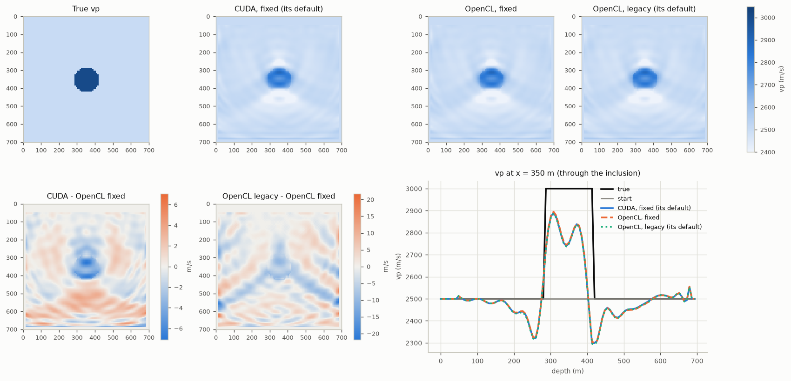
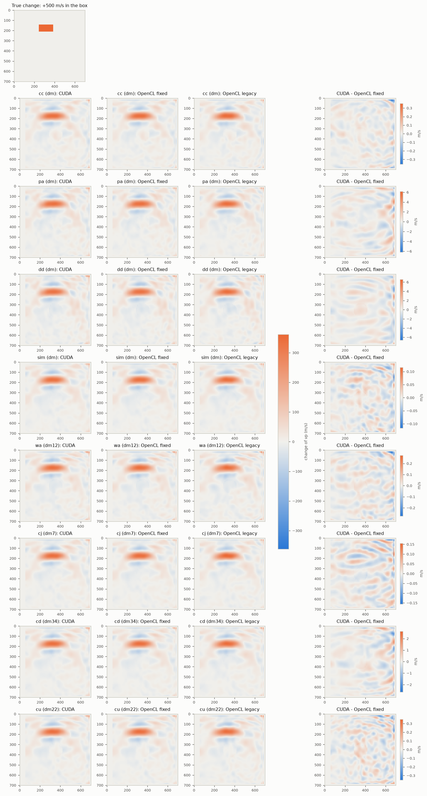
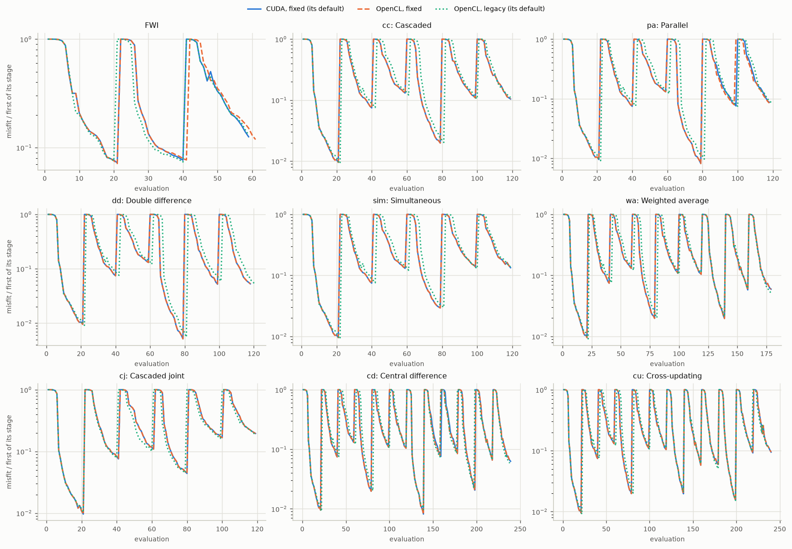

# Geophysical validation of the CUDA backend (PyFWI 0.4.0.dev0)

Complete inversions on the GPU of the project, the CUDA backend side by side with the OpenCL backend, for the review of a geophysicist (roadmap step 4.6). Written by `tools/geophysical_validation.py` from `bench/geophysical-0.4.0.dev0/`; the cases, the departures from the examples and the metrics are described in the docstring of the script.

## How to read it

- **FWI** (full-waveform inversion) changes a model of the subsurface, here the P-wave velocity vp, until the seismograms it predicts match the observed ones. The **misfit** measures the mismatch; each **evaluation** computes it and its gradient (one forward modelling and one adjoint modelling per source). **Multi-scale**: the data are low-pass filtered, from the lowest band to the highest, each band (a **stage**) starting from the result of the previous one.
- **Time-lapse** FWI recovers what changed between two surveys of the same area (a baseline and a monitor), here a 20 % increase of vp in a box. PyFWI has eight strategies, which differ by the order and the starting models of their inversions.
- Every case runs in three **configurations**: **CUDA, fixed (its default)**; **OpenCL, fixed**; **OpenCL, legacy (its default)**. The `fixed` numeric mode corrects known errors of the arithmetic of PyFWI 0.1.10, which the `legacy` mode keeps. CUDA against OpenCL in the same mode measures the backend; legacy against fixed measures the corrections.
- Differences between configurations are given relative to what the inversion recovers: `||a - b|| / ||true model - starting model||` for FWI, `||a - b|| / ||true change||` for time-lapse.
- Two configurations never compute the same bits: their kernels and compilers round differently (about 1e-6 of a gradient for CUDA against OpenCL in the same mode, `parity` reports). An inversion amplifies these differences: a slightly different gradient changes the steps of the line search, sometimes the number of evaluations, and the paths of the two inversions part a little more at every iteration. What matters for the review is whether the estimates lead to the same interpretation: the metrics of the tables, and the figures.

## Summary

- The misfit decreased in every stage of every inversion (198 stages).
- Largest difference for the backend: CUDA against OpenCL, both in the fixed mode: 1.67 % of what the inversion recovers (fwi, `vp`); the metrics of the two differ by at most 0.008.
- Largest difference for the numeric mode: legacy against fixed, both on OpenCL: 15.18 % of what the inversion recovers (cu, `dm21`); the metrics of the two differ by at most 0.021.
- Largest difference for the defaults: CUDA (fixed) against OpenCL (legacy): 15.19 % of what the inversion recovers (cu, `dm21`); the metrics of the two differ by at most 0.021.
- FWI: model error after the inversion over the error of the starting model: CUDA, fixed (its default) 0.648, OpenCL, fixed 0.643, OpenCL, legacy (its default) 0.655.
- Time-lapse: the correlation of the main estimates with the true change goes from 0.70 (wa, OpenCL, legacy (its default)) to 0.75 (cj, OpenCL, fixed).

## Environment

- PyFWI: 0.4.0.dev0
- Python: 3.12.15
- NumPy: 2.5.4
- SciPy: 1.18.1
- OpenCL device: NVIDIA GeForce RTX 3060 (NVIDIA CUDA, OpenCL 3.0 CUDA 13.0.94)
- PyOpenCL: 2026.1.4
- CUDA device: NVIDIA GeForce RTX 3060 (CUDA device 0)
- CUDA runtime: 13020
- CUDA driver: 13000
- CuPy: 14.2.0

## The cases

- Model of Louboutin et al. (2018), 100 x 100 cells of 7 m: vp 2500 m/s with an inclusion at 3000 m/s (radius 10 cells), vs from a Poisson's ratio of 0.25, density from Gardner's relation. Starting model: vp 2500 m/s everywhere, the true vs and density; vp only is inverted.
- 4 sources, Ricker wavelet of 15 Hz (times 1000), 0.6 s of pressure recordings, 4th-order finite differences, absorbing layers of 20 cells; L-BFGS with energy balancing; bands below 15, 25, 45 Hz, 15, 15, 15 iterations.
- FWI: surface acquisition. Time-lapse: crosswell acquisition (sources in a well on the left, receivers in a well on the right); the monitor has vp 20 % higher in a box above the inclusion (as `example/tlfwi_example_crosswell.ipynb`).

## Multi-scale FWI

Top: the true vp and the estimate of every configuration. Bottom: the differences of two estimates (note their colour scales) and a vertical profile through the inclusion.

| Configuration | Error ratio | Contrast recovered | Evaluations | Time (s) |
| --- | --- | --- | --- | --- |
| CUDA, fixed (its default) | 0.648 | 48.9 % | 59 | 7.7 |
| OpenCL, fixed | 0.643 | 49.8 % | 61 | 62.0 |
| OpenCL, legacy (its default) | 0.655 | 48.5 % | 59 | 73.0 |

Error ratio: `||estimate - true|| / ||start - true||` (lower is better). Contrast recovered: the mean increase of vp inside the inclusion over the true one.

Differences between configurations, FWI:

| Estimate | backend | numerics | defaults |
| --- | --- | --- | --- |
| `vp` | 1.67 % | 3.98 % | 3.55 % |

(`backend`: CUDA against OpenCL, both in the fixed mode; `numerics`: legacy against fixed, both on OpenCL; `defaults`: CUDA (fixed) against OpenCL (legacy).)

## Time-lapse strategies

The main estimate of every strategy (the one that uses all its inversions); the estimates share one colour scale, the true change (top) and the differences of CUDA and OpenCL in the fixed mode (last column) have their own.

| Strategy | What it does |
| --- | --- |
| `cc` Cascaded | the baseline from the starting model, then the monitor from the baseline result; dm = monitor - baseline |
| `pa` Parallel | the baseline and the monitor, each from the starting model; dm = monitor - baseline |
| `dd` Double difference | the baseline, then the composite data (monitor data - baseline data + the data of the baseline result) from the starting model; dm = composite - baseline |
| `sim` Simultaneous | the baseline, then the baseline and the monitor together (one misfit for both data sets) from the baseline result; dm = monitor - baseline |
| `wa` Weighted average | cascaded, then the baseline again from the monitor result: dm11 = m1 - b1, dm12 = m1 - b2 (the weights of the average are not in PyFWI) |
| `cj` Cascaded joint | a simultaneous inversion from the starting model, then another from the average of its two models: dm0 = m1 - b1, dm7 = m2 - b2, dm3 = m2 - b1, dm6 = m1 - b2 |
| `cd` Central difference | baseline then monitor, and monitor then baseline, both from the starting model: dm3 and dm4 are the two cascaded differences, dm34 their average, dm0 and dm1 the differences of the parallel and of the second inversions |
| `cu` Cross-updating | baseline, monitor, baseline, monitor, each from the previous result (Maharramov and Biondi, 2014): dmij = mi - bj |

Every estimate (`*`: the main one). Recovered: the mean of the estimate inside the box over the true change. Correlation: with the true change over the model. Artefacts: the root mean square outside the box over the true change.

| Strategy | Estimate | Configuration | Recovered | Correlation | Artefacts | Evaluations | Time (s) |
| --- | --- | --- | --- | --- | --- | --- | --- |
| `cc` | `dm`* | CUDA, fixed (its default) | 51.3 % | 0.74 | 6.2 % | 119 | 15.2 |
| `cc` | `dm`* | OpenCL, fixed | 51.3 % | 0.74 | 6.2 % | 119 | 119.6 |
| `cc` | `dm`* | OpenCL, legacy (its default) | 51.5 % | 0.74 | 6.3 % | 119 | 144.8 |
| `pa` | `dm`* | CUDA, fixed (its default) | 50.2 % | 0.73 | 6.4 % | 118 | 14.1 |
| `pa` | `dm`* | OpenCL, fixed | 50.2 % | 0.73 | 6.4 % | 118 | 117.2 |
| `pa` | `dm`* | OpenCL, legacy (its default) | 50.0 % | 0.73 | 6.4 % | 119 | 144.9 |
| `dd` | `dm`* | CUDA, fixed (its default) | 49.4 % | 0.71 | 6.6 % | 118 | 13.9 |
| `dd` | `dm`* | OpenCL, fixed | 49.3 % | 0.71 | 6.6 % | 118 | 117.8 |
| `dd` | `dm`* | OpenCL, legacy (its default) | 49.3 % | 0.71 | 6.6 % | 121 | 147.0 |
| `sim` | `dm`* | CUDA, fixed (its default) | 50.0 % | 0.74 | 6.2 % | 119 | 22.0 |
| `sim` | `dm`* | OpenCL, fixed | 50.0 % | 0.74 | 6.2 % | 119 | 179.6 |
| `sim` | `dm`* | OpenCL, legacy (its default) | 49.8 % | 0.73 | 6.3 % | 119 | 217.3 |
| `wa` | `dm11` | CUDA, fixed (its default) | 51.3 % | 0.74 | 6.2 % | 179 | 20.4 |
| `wa` | `dm12`* | CUDA, fixed (its default) | 49.6 % | 0.72 | 6.4 % | 179 | 20.4 |
| `wa` | `dm11` | OpenCL, fixed | 51.3 % | 0.74 | 6.2 % | 179 | 178.2 |
| `wa` | `dm12`* | OpenCL, fixed | 49.6 % | 0.72 | 6.4 % | 179 | 178.2 |
| `wa` | `dm11` | OpenCL, legacy (its default) | 51.5 % | 0.74 | 6.3 % | 179 | 219.4 |
| `wa` | `dm12`* | OpenCL, legacy (its default) | 48.7 % | 0.70 | 6.7 % | 179 | 219.4 |
| `cj` | `dm0` | CUDA, fixed (its default) | 48.6 % | 0.72 | 6.3 % | 119 | 29.5 |
| `cj` | `dm3` | CUDA, fixed (its default) | 51.2 % | 0.74 | 6.3 % | 119 | 29.5 |
| `cj` | `dm6` | CUDA, fixed (its default) | 48.3 % | 0.70 | 6.6 % | 119 | 29.5 |
| `cj` | `dm7`* | CUDA, fixed (its default) | 50.8 % | 0.75 | 6.1 % | 119 | 29.5 |
| `cj` | `dm0` | OpenCL, fixed | 48.6 % | 0.72 | 6.3 % | 119 | 247.3 |
| `cj` | `dm3` | OpenCL, fixed | 51.2 % | 0.74 | 6.3 % | 119 | 247.3 |
| `cj` | `dm6` | OpenCL, fixed | 48.3 % | 0.70 | 6.6 % | 119 | 247.3 |
| `cj` | `dm7`* | OpenCL, fixed | 50.8 % | 0.75 | 6.1 % | 119 | 247.3 |
| `cj` | `dm0` | OpenCL, legacy (its default) | 49.0 % | 0.72 | 6.3 % | 119 | 291.4 |
| `cj` | `dm3` | OpenCL, legacy (its default) | 52.3 % | 0.74 | 6.3 % | 119 | 291.4 |
| `cj` | `dm6` | OpenCL, legacy (its default) | 48.1 % | 0.69 | 6.8 % | 119 | 291.4 |
| `cj` | `dm7`* | OpenCL, legacy (its default) | 51.4 % | 0.75 | 6.1 % | 119 | 291.4 |
| `cd` | `dm0` | CUDA, fixed (its default) | 50.2 % | 0.73 | 6.4 % | 239 | 27.6 |
| `cd` | `dm1` | CUDA, fixed (its default) | 50.4 % | 0.73 | 6.3 % | 239 | 27.6 |
| `cd` | `dm3` | CUDA, fixed (its default) | 51.3 % | 0.74 | 6.2 % | 239 | 27.6 |
| `cd` | `dm34`* | CUDA, fixed (its default) | 50.3 % | 0.74 | 6.2 % | 239 | 27.6 |
| `cd` | `dm4` | CUDA, fixed (its default) | 49.4 % | 0.71 | 6.6 % | 239 | 27.6 |
| `cd` | `dm0` | OpenCL, fixed | 50.2 % | 0.73 | 6.4 % | 239 | 238.0 |
| `cd` | `dm1` | OpenCL, fixed | 50.4 % | 0.73 | 6.3 % | 239 | 238.0 |
| `cd` | `dm3` | OpenCL, fixed | 51.3 % | 0.74 | 6.2 % | 239 | 238.0 |
| `cd` | `dm34`* | OpenCL, fixed | 50.3 % | 0.74 | 6.2 % | 239 | 238.0 |
| `cd` | `dm4` | OpenCL, fixed | 49.4 % | 0.71 | 6.6 % | 239 | 238.0 |
| `cd` | `dm0` | OpenCL, legacy (its default) | 50.0 % | 0.73 | 6.4 % | 238 | 289.5 |
| `cd` | `dm1` | OpenCL, legacy (its default) | 50.2 % | 0.72 | 6.5 % | 238 | 289.5 |
| `cd` | `dm3` | OpenCL, legacy (its default) | 51.5 % | 0.74 | 6.3 % | 238 | 289.5 |
| `cd` | `dm34`* | OpenCL, legacy (its default) | 50.1 % | 0.73 | 6.3 % | 238 | 289.5 |
| `cd` | `dm4` | OpenCL, legacy (its default) | 48.6 % | 0.70 | 6.8 % | 238 | 289.5 |
| `cu` | `dm11` | CUDA, fixed (its default) | 51.3 % | 0.74 | 6.2 % | 240 | 28.0 |
| `cu` | `dm12` | CUDA, fixed (its default) | 49.6 % | 0.72 | 6.4 % | 240 | 28.0 |
| `cu` | `dm21` | CUDA, fixed (its default) | 52.4 % | 0.73 | 6.7 % | 240 | 28.0 |
| `cu` | `dm22`* | CUDA, fixed (its default) | 50.7 % | 0.74 | 6.2 % | 240 | 28.0 |
| `cu` | `dm11` | OpenCL, fixed | 51.3 % | 0.74 | 6.2 % | 240 | 240.6 |
| `cu` | `dm12` | OpenCL, fixed | 49.6 % | 0.72 | 6.4 % | 240 | 240.6 |
| `cu` | `dm21` | OpenCL, fixed | 52.3 % | 0.73 | 6.7 % | 240 | 240.6 |
| `cu` | `dm22`* | OpenCL, fixed | 50.7 % | 0.74 | 6.2 % | 240 | 240.6 |
| `cu` | `dm11` | OpenCL, legacy (its default) | 51.5 % | 0.74 | 6.3 % | 238 | 298.4 |
| `cu` | `dm12` | OpenCL, legacy (its default) | 48.7 % | 0.70 | 6.7 % | 238 | 298.4 |
| `cu` | `dm21` | OpenCL, legacy (its default) | 52.8 % | 0.73 | 6.7 % | 238 | 298.4 |
| `cu` | `dm22`* | OpenCL, legacy (its default) | 50.0 % | 0.73 | 6.4 % | 238 | 298.4 |

Differences between configurations, `cc`:

| Estimate | backend | numerics | defaults |
| --- | --- | --- | --- |
| `dm` | 3.9e-04 | 8.02 % | 8.03 % |

(`backend`: CUDA against OpenCL, both in the fixed mode; `numerics`: legacy against fixed, both on OpenCL; `defaults`: CUDA (fixed) against OpenCL (legacy).)

Differences between configurations, `pa`:

| Estimate | backend | numerics | defaults |
| --- | --- | --- | --- |
| `dm` | 0.85 % | 7.86 % | 7.66 % |

(`backend`: CUDA against OpenCL, both in the fixed mode; `numerics`: legacy against fixed, both on OpenCL; `defaults`: CUDA (fixed) against OpenCL (legacy).)

Differences between configurations, `dd`:

| Estimate | backend | numerics | defaults |
| --- | --- | --- | --- |
| `dm` | 0.78 % | 7.95 % | 7.98 % |

(`backend`: CUDA against OpenCL, both in the fixed mode; `numerics`: legacy against fixed, both on OpenCL; `defaults`: CUDA (fixed) against OpenCL (legacy).)

Differences between configurations, `sim`:

| Estimate | backend | numerics | defaults |
| --- | --- | --- | --- |
| `dm` | 1.9e-04 | 5.52 % | 5.52 % |

(`backend`: CUDA against OpenCL, both in the fixed mode; `numerics`: legacy against fixed, both on OpenCL; `defaults`: CUDA (fixed) against OpenCL (legacy).)

Differences between configurations, `wa`:

| Estimate | backend | numerics | defaults |
| --- | --- | --- | --- |
| `dm11` | 3.9e-04 | 8.02 % | 8.03 % |
| `dm12` | 3.9e-04 | 9.09 % | 9.09 % |

(`backend`: CUDA against OpenCL, both in the fixed mode; `numerics`: legacy against fixed, both on OpenCL; `defaults`: CUDA (fixed) against OpenCL (legacy).)

Differences between configurations, `cj`:

| Estimate | backend | numerics | defaults |
| --- | --- | --- | --- |
| `dm0` | 5.6e-05 | 5.81 % | 5.81 % |
| `dm3` | 2.4e-04 | 9.76 % | 9.77 % |
| `dm6` | 1.8e-04 | 9.27 % | 9.28 % |
| `dm7` | 2.9e-04 | 7.94 % | 7.96 % |

(`backend`: CUDA against OpenCL, both in the fixed mode; `numerics`: legacy against fixed, both on OpenCL; `defaults`: CUDA (fixed) against OpenCL (legacy).)

Differences between configurations, `cd`:

| Estimate | backend | numerics | defaults |
| --- | --- | --- | --- |
| `dm0` | 0.85 % | 7.86 % | 7.66 % |
| `dm1` | 0.37 % | 8.37 % | 8.42 % |
| `dm3` | 3.9e-04 | 8.02 % | 8.03 % |
| `dm34` | 0.40 % | 6.36 % | 6.33 % |
| `dm4` | 0.80 % | 9.03 % | 8.98 % |

(`backend`: CUDA against OpenCL, both in the fixed mode; `numerics`: legacy against fixed, both on OpenCL; `defaults`: CUDA (fixed) against OpenCL (legacy).)

Differences between configurations, `cu`:

| Estimate | backend | numerics | defaults |
| --- | --- | --- | --- |
| `dm11` | 3.9e-04 | 8.02 % | 8.03 % |
| `dm12` | 3.9e-04 | 9.09 % | 9.09 % |
| `dm21` | 7.0e-04 | 15.18 % | 15.19 % |
| `dm22` | 5.6e-04 | 8.44 % | 8.45 % |

(`backend`: CUDA against OpenCL, both in the fixed mode; `numerics`: legacy against fixed, both on OpenCL; `defaults`: CUDA (fixed) against OpenCL (legacy).)

## Misfit curves

The misfit of every evaluation over the first one of its stage, the stages and inversions of a case one after the other: the curve goes back to 1 where a stage starts. The first and last misfit of every stage:

| Case | Configuration | Stage | Band (Hz) | First misfit | Last misfit | Evaluations |
| --- | --- | --- | --- | --- | --- | --- |
| fwi | CUDA, fixed (its default) | 1 (inversion 1, fwi) | 15 | 0.2557 | 0.0185 | 21 |
| fwi | CUDA, fixed (its default) | 2 (inversion 1, fwi) | 25 | 0.3434 | 0.02626 | 19 |
| fwi | CUDA, fixed (its default) | 3 (inversion 1, fwi) | 45 | 1.814 | 0.2279 | 19 |
| fwi | OpenCL, fixed | 1 (inversion 1, fwi) | 15 | 0.2557 | 0.01821 | 21 |
| fwi | OpenCL, fixed | 2 (inversion 1, fwi) | 25 | 0.3398 | 0.02612 | 20 |
| fwi | OpenCL, fixed | 3 (inversion 1, fwi) | 45 | 1.781 | 0.2113 | 20 |
| fwi | OpenCL, legacy (its default) | 1 (inversion 1, fwi) | 15 | 0.2561 | 0.0193 | 20 |
| fwi | OpenCL, legacy (its default) | 2 (inversion 1, fwi) | 25 | 0.3803 | 0.028 | 20 |
| fwi | OpenCL, legacy (its default) | 3 (inversion 1, fwi) | 45 | 1.864 | 0.2436 | 19 |
| cc | CUDA, fixed (its default) | 1 (inversion 1, fwi) | 15 | 0.3662 | 0.003493 | 21 |
| cc | CUDA, fixed (its default) | 2 (inversion 1, fwi) | 25 | 0.3411 | 0.02537 | 19 |
| cc | CUDA, fixed (its default) | 3 (inversion 1, fwi) | 45 | 3.505 | 0.457 | 19 |
| cc | CUDA, fixed (its default) | 4 (inversion 2, fwi) | 15 | 0.08015 | 0.001583 | 20 |
| cc | CUDA, fixed (its default) | 5 (inversion 2, fwi) | 25 | 0.2684 | 0.02905 | 20 |
| cc | CUDA, fixed (its default) | 6 (inversion 2, fwi) | 45 | 6.793 | 0.7079 | 20 |
| cc | OpenCL, fixed | 1 (inversion 1, fwi) | 15 | 0.3662 | 0.003483 | 21 |
| cc | OpenCL, fixed | 2 (inversion 1, fwi) | 25 | 0.3405 | 0.02538 | 19 |
| cc | OpenCL, fixed | 3 (inversion 1, fwi) | 45 | 3.503 | 0.4574 | 19 |
| cc | OpenCL, fixed | 4 (inversion 2, fwi) | 15 | 0.08015 | 0.001583 | 20 |
| cc | OpenCL, fixed | 5 (inversion 2, fwi) | 25 | 0.2684 | 0.02907 | 20 |
| cc | OpenCL, fixed | 6 (inversion 2, fwi) | 45 | 6.796 | 0.7088 | 20 |
| cc | OpenCL, legacy (its default) | 1 (inversion 1, fwi) | 15 | 0.3678 | 0.00335 | 22 |
| cc | OpenCL, legacy (its default) | 2 (inversion 1, fwi) | 25 | 0.333 | 0.02521 | 20 |
| cc | OpenCL, legacy (its default) | 3 (inversion 1, fwi) | 45 | 3.658 | 0.4433 | 19 |
| cc | OpenCL, legacy (its default) | 4 (inversion 2, fwi) | 15 | 0.08091 | 0.001635 | 20 |
| cc | OpenCL, legacy (its default) | 5 (inversion 2, fwi) | 25 | 0.2792 | 0.02932 | 19 |
| cc | OpenCL, legacy (its default) | 6 (inversion 2, fwi) | 45 | 7 | 0.776 | 19 |
| pa | CUDA, fixed (its default) | 1 (inversion 1, fwi) | 15 | 0.3662 | 0.003493 | 21 |
| pa | CUDA, fixed (its default) | 2 (inversion 1, fwi) | 25 | 0.3411 | 0.02537 | 19 |
| pa | CUDA, fixed (its default) | 3 (inversion 1, fwi) | 45 | 3.505 | 0.457 | 19 |
| pa | CUDA, fixed (its default) | 4 (inversion 2, fwi) | 15 | 0.5437 | 0.00444 | 20 |
| pa | CUDA, fixed (its default) | 5 (inversion 2, fwi) | 25 | 0.6514 | 0.04926 | 20 |
| pa | CUDA, fixed (its default) | 6 (inversion 2, fwi) | 45 | 10.75 | 0.9373 | 19 |
| pa | OpenCL, fixed | 1 (inversion 1, fwi) | 15 | 0.3662 | 0.003483 | 21 |
| pa | OpenCL, fixed | 2 (inversion 1, fwi) | 25 | 0.3405 | 0.02538 | 19 |
| pa | OpenCL, fixed | 3 (inversion 1, fwi) | 45 | 3.503 | 0.4574 | 19 |
| pa | OpenCL, fixed | 4 (inversion 2, fwi) | 15 | 0.5437 | 0.004433 | 20 |
| pa | OpenCL, fixed | 5 (inversion 2, fwi) | 25 | 0.6509 | 0.05149 | 19 |
| pa | OpenCL, fixed | 6 (inversion 2, fwi) | 45 | 11.03 | 0.9307 | 20 |
| pa | OpenCL, legacy (its default) | 1 (inversion 1, fwi) | 15 | 0.3678 | 0.00335 | 22 |
| pa | OpenCL, legacy (its default) | 2 (inversion 1, fwi) | 25 | 0.333 | 0.02521 | 20 |
| pa | OpenCL, legacy (its default) | 3 (inversion 1, fwi) | 45 | 3.658 | 0.4433 | 19 |
| pa | OpenCL, legacy (its default) | 4 (inversion 2, fwi) | 15 | 0.546 | 0.005287 | 20 |
| pa | OpenCL, legacy (its default) | 5 (inversion 2, fwi) | 25 | 0.7626 | 0.05694 | 19 |
| pa | OpenCL, legacy (its default) | 6 (inversion 2, fwi) | 45 | 11.72 | 1.013 | 19 |
| dd | CUDA, fixed (its default) | 1 (inversion 1, fwi) | 15 | 0.3662 | 0.003493 | 21 |
| dd | CUDA, fixed (its default) | 2 (inversion 1, fwi) | 25 | 0.3411 | 0.02537 | 19 |
| dd | CUDA, fixed (its default) | 3 (inversion 1, fwi) | 45 | 3.505 | 0.457 | 19 |
| dd | CUDA, fixed (its default) | 4 (inversion 2, fwi) | 15 | 0.5566 | 0.002869 | 20 |
| dd | CUDA, fixed (its default) | 5 (inversion 2, fwi) | 25 | 0.5436 | 0.02828 | 20 |
| dd | CUDA, fixed (its default) | 6 (inversion 2, fwi) | 45 | 8.762 | 0.4634 | 19 |
| dd | OpenCL, fixed | 1 (inversion 1, fwi) | 15 | 0.3662 | 0.003483 | 21 |
| dd | OpenCL, fixed | 2 (inversion 1, fwi) | 25 | 0.3405 | 0.02538 | 19 |
| dd | OpenCL, fixed | 3 (inversion 1, fwi) | 45 | 3.503 | 0.4574 | 19 |
| dd | OpenCL, fixed | 4 (inversion 2, fwi) | 15 | 0.5567 | 0.00287 | 20 |
| dd | OpenCL, fixed | 5 (inversion 2, fwi) | 25 | 0.5434 | 0.02879 | 20 |
| dd | OpenCL, fixed | 6 (inversion 2, fwi) | 45 | 8.883 | 0.4706 | 19 |
| dd | OpenCL, legacy (its default) | 1 (inversion 1, fwi) | 15 | 0.3678 | 0.00335 | 22 |
| dd | OpenCL, legacy (its default) | 2 (inversion 1, fwi) | 25 | 0.333 | 0.02521 | 20 |
| dd | OpenCL, legacy (its default) | 3 (inversion 1, fwi) | 45 | 3.658 | 0.4433 | 19 |
| dd | OpenCL, legacy (its default) | 4 (inversion 2, fwi) | 15 | 0.559 | 0.00311 | 20 |
| dd | OpenCL, legacy (its default) | 5 (inversion 2, fwi) | 25 | 0.5611 | 0.03316 | 20 |
| dd | OpenCL, legacy (its default) | 6 (inversion 2, fwi) | 45 | 9.59 | 0.5121 | 20 |
| sim | CUDA, fixed (its default) | 1 (inversion 1, fwi) | 15 | 0.3662 | 0.003493 | 21 |
| sim | CUDA, fixed (its default) | 2 (inversion 1, fwi) | 25 | 0.3411 | 0.02537 | 19 |
| sim | CUDA, fixed (its default) | 3 (inversion 1, fwi) | 45 | 3.505 | 0.457 | 19 |
| sim | CUDA, fixed (its default) | 4 (inversion 2, joint) | 15 | 0.08213 | 0.002401 | 20 |
| sim | CUDA, fixed (its default) | 5 (inversion 2, joint) | 25 | 0.3039 | 0.04206 | 20 |
| sim | CUDA, fixed (its default) | 6 (inversion 2, joint) | 45 | 8.485 | 1.133 | 20 |
| sim | OpenCL, fixed | 1 (inversion 1, fwi) | 15 | 0.3662 | 0.003483 | 21 |
| sim | OpenCL, fixed | 2 (inversion 1, fwi) | 25 | 0.3405 | 0.02538 | 19 |
| sim | OpenCL, fixed | 3 (inversion 1, fwi) | 45 | 3.503 | 0.4574 | 19 |
| sim | OpenCL, fixed | 4 (inversion 2, joint) | 15 | 0.08212 | 0.002401 | 20 |
| sim | OpenCL, fixed | 5 (inversion 2, joint) | 25 | 0.3041 | 0.04209 | 20 |
| sim | OpenCL, fixed | 6 (inversion 2, joint) | 45 | 8.489 | 1.134 | 20 |
| sim | OpenCL, legacy (its default) | 1 (inversion 1, fwi) | 15 | 0.3678 | 0.00335 | 22 |
| sim | OpenCL, legacy (its default) | 2 (inversion 1, fwi) | 25 | 0.333 | 0.02521 | 20 |
| sim | OpenCL, legacy (its default) | 3 (inversion 1, fwi) | 45 | 3.658 | 0.4433 | 19 |
| sim | OpenCL, legacy (its default) | 4 (inversion 2, joint) | 15 | 0.08283 | 0.002481 | 20 |
| sim | OpenCL, legacy (its default) | 5 (inversion 2, joint) | 25 | 0.316 | 0.04102 | 19 |
| sim | OpenCL, legacy (its default) | 6 (inversion 2, joint) | 45 | 8.256 | 1.147 | 19 |
| wa | CUDA, fixed (its default) | 1 (inversion 1, fwi) | 15 | 0.3662 | 0.003493 | 21 |
| wa | CUDA, fixed (its default) | 2 (inversion 1, fwi) | 25 | 0.3411 | 0.02537 | 19 |
| wa | CUDA, fixed (its default) | 3 (inversion 1, fwi) | 45 | 3.505 | 0.457 | 19 |
| wa | CUDA, fixed (its default) | 4 (inversion 2, fwi) | 15 | 0.08015 | 0.001583 | 20 |
| wa | CUDA, fixed (its default) | 5 (inversion 2, fwi) | 25 | 0.2684 | 0.02905 | 20 |
| wa | CUDA, fixed (its default) | 6 (inversion 2, fwi) | 45 | 6.793 | 0.7079 | 20 |
| wa | CUDA, fixed (its default) | 7 (inversion 3, fwi) | 15 | 0.08641 | 0.001696 | 20 |
| wa | CUDA, fixed (its default) | 8 (inversion 3, fwi) | 25 | 0.3231 | 0.01867 | 20 |
| wa | CUDA, fixed (its default) | 9 (inversion 3, fwi) | 45 | 4.738 | 0.2815 | 20 |
| wa | OpenCL, fixed | 1 (inversion 1, fwi) | 15 | 0.3662 | 0.003483 | 21 |
| wa | OpenCL, fixed | 2 (inversion 1, fwi) | 25 | 0.3405 | 0.02538 | 19 |
| wa | OpenCL, fixed | 3 (inversion 1, fwi) | 45 | 3.503 | 0.4574 | 19 |
| wa | OpenCL, fixed | 4 (inversion 2, fwi) | 15 | 0.08015 | 0.001583 | 20 |
| wa | OpenCL, fixed | 5 (inversion 2, fwi) | 25 | 0.2684 | 0.02907 | 20 |
| wa | OpenCL, fixed | 6 (inversion 2, fwi) | 45 | 6.796 | 0.7088 | 20 |
| wa | OpenCL, fixed | 7 (inversion 3, fwi) | 15 | 0.08641 | 0.001696 | 20 |
| wa | OpenCL, fixed | 8 (inversion 3, fwi) | 25 | 0.323 | 0.01866 | 20 |
| wa | OpenCL, fixed | 9 (inversion 3, fwi) | 45 | 4.734 | 0.2815 | 20 |
| wa | OpenCL, legacy (its default) | 1 (inversion 1, fwi) | 15 | 0.3678 | 0.00335 | 22 |
| wa | OpenCL, legacy (its default) | 2 (inversion 1, fwi) | 25 | 0.333 | 0.02521 | 20 |
| wa | OpenCL, legacy (its default) | 3 (inversion 1, fwi) | 45 | 3.658 | 0.4433 | 19 |
| wa | OpenCL, legacy (its default) | 4 (inversion 2, fwi) | 15 | 0.08091 | 0.001635 | 20 |
| wa | OpenCL, legacy (its default) | 5 (inversion 2, fwi) | 25 | 0.2792 | 0.02932 | 19 |
| wa | OpenCL, legacy (its default) | 6 (inversion 2, fwi) | 45 | 7 | 0.776 | 19 |
| wa | OpenCL, legacy (its default) | 7 (inversion 3, fwi) | 15 | 0.0871 | 0.001837 | 20 |
| wa | OpenCL, legacy (its default) | 8 (inversion 3, fwi) | 25 | 0.3392 | 0.02079 | 20 |
| wa | OpenCL, legacy (its default) | 9 (inversion 3, fwi) | 45 | 5.95 | 0.301 | 20 |
| cj | CUDA, fixed (its default) | 1 (inversion 1, joint) | 15 | 0.9099 | 0.008754 | 21 |
| cj | CUDA, fixed (its default) | 2 (inversion 1, joint) | 25 | 1.085 | 0.08196 | 20 |
| cj | CUDA, fixed (its default) | 3 (inversion 1, joint) | 45 | 14.93 | 1.626 | 20 |
| cj | CUDA, fixed (its default) | 4 (inversion 2, joint) | 15 | 0.0466 | 0.002043 | 19 |
| cj | CUDA, fixed (its default) | 5 (inversion 2, joint) | 25 | 0.199 | 0.03326 | 20 |
| cj | CUDA, fixed (its default) | 6 (inversion 2, joint) | 45 | 5.631 | 1.098 | 19 |
| cj | OpenCL, fixed | 1 (inversion 1, joint) | 15 | 0.9099 | 0.008755 | 21 |
| cj | OpenCL, fixed | 2 (inversion 1, joint) | 25 | 1.085 | 0.08194 | 20 |
| cj | OpenCL, fixed | 3 (inversion 1, joint) | 45 | 14.93 | 1.626 | 20 |
| cj | OpenCL, fixed | 4 (inversion 2, joint) | 15 | 0.0466 | 0.00204 | 19 |
| cj | OpenCL, fixed | 5 (inversion 2, joint) | 25 | 0.199 | 0.03327 | 20 |
| cj | OpenCL, fixed | 6 (inversion 2, joint) | 45 | 5.633 | 1.097 | 19 |
| cj | OpenCL, legacy (its default) | 1 (inversion 1, joint) | 15 | 0.9138 | 0.009414 | 21 |
| cj | OpenCL, legacy (its default) | 2 (inversion 1, joint) | 25 | 1.151 | 0.08991 | 19 |
| cj | OpenCL, legacy (its default) | 3 (inversion 1, joint) | 45 | 16.53 | 1.657 | 20 |
| cj | OpenCL, legacy (its default) | 4 (inversion 2, joint) | 15 | 0.04692 | 0.002105 | 19 |
| cj | OpenCL, legacy (its default) | 5 (inversion 2, joint) | 25 | 0.1977 | 0.03207 | 20 |
| cj | OpenCL, legacy (its default) | 6 (inversion 2, joint) | 45 | 5.505 | 1.033 | 20 |
| cd | CUDA, fixed (its default) | 1 (inversion 1, fwi) | 15 | 0.3662 | 0.003493 | 21 |
| cd | CUDA, fixed (its default) | 2 (inversion 1, fwi) | 25 | 0.3411 | 0.02537 | 19 |
| cd | CUDA, fixed (its default) | 3 (inversion 1, fwi) | 45 | 3.505 | 0.457 | 19 |
| cd | CUDA, fixed (its default) | 4 (inversion 2, fwi) | 15 | 0.08015 | 0.001583 | 20 |
| cd | CUDA, fixed (its default) | 5 (inversion 2, fwi) | 25 | 0.2684 | 0.02905 | 20 |
| cd | CUDA, fixed (its default) | 6 (inversion 2, fwi) | 45 | 6.793 | 0.7079 | 20 |
| cd | CUDA, fixed (its default) | 7 (inversion 3, fwi) | 15 | 0.5437 | 0.00444 | 20 |
| cd | CUDA, fixed (its default) | 8 (inversion 3, fwi) | 25 | 0.6514 | 0.04926 | 20 |
| cd | CUDA, fixed (its default) | 9 (inversion 3, fwi) | 45 | 10.75 | 0.9373 | 19 |
| cd | CUDA, fixed (its default) | 10 (inversion 4, fwi) | 15 | 0.08723 | 0.001794 | 20 |
| cd | CUDA, fixed (its default) | 11 (inversion 4, fwi) | 25 | 0.3221 | 0.02128 | 20 |
| cd | CUDA, fixed (its default) | 12 (inversion 4, fwi) | 45 | 5.381 | 0.3382 | 21 |
| cd | OpenCL, fixed | 1 (inversion 1, fwi) | 15 | 0.3662 | 0.003483 | 21 |
| cd | OpenCL, fixed | 2 (inversion 1, fwi) | 25 | 0.3405 | 0.02538 | 19 |
| cd | OpenCL, fixed | 3 (inversion 1, fwi) | 45 | 3.503 | 0.4574 | 19 |
| cd | OpenCL, fixed | 4 (inversion 2, fwi) | 15 | 0.08015 | 0.001583 | 20 |
| cd | OpenCL, fixed | 5 (inversion 2, fwi) | 25 | 0.2684 | 0.02907 | 20 |
| cd | OpenCL, fixed | 6 (inversion 2, fwi) | 45 | 6.796 | 0.7088 | 20 |
| cd | OpenCL, fixed | 7 (inversion 3, fwi) | 15 | 0.5437 | 0.004433 | 20 |
| cd | OpenCL, fixed | 8 (inversion 3, fwi) | 25 | 0.6509 | 0.05149 | 19 |
| cd | OpenCL, fixed | 9 (inversion 3, fwi) | 45 | 11.03 | 0.9307 | 20 |
| cd | OpenCL, fixed | 10 (inversion 4, fwi) | 15 | 0.08694 | 0.001791 | 20 |
| cd | OpenCL, fixed | 11 (inversion 4, fwi) | 25 | 0.322 | 0.02114 | 20 |
| cd | OpenCL, fixed | 12 (inversion 4, fwi) | 45 | 5.327 | 0.3356 | 21 |
| cd | OpenCL, legacy (its default) | 1 (inversion 1, fwi) | 15 | 0.3678 | 0.00335 | 22 |
| cd | OpenCL, legacy (its default) | 2 (inversion 1, fwi) | 25 | 0.333 | 0.02521 | 20 |
| cd | OpenCL, legacy (its default) | 3 (inversion 1, fwi) | 45 | 3.658 | 0.4433 | 19 |
| cd | OpenCL, legacy (its default) | 4 (inversion 2, fwi) | 15 | 0.08091 | 0.001635 | 20 |
| cd | OpenCL, legacy (its default) | 5 (inversion 2, fwi) | 25 | 0.2792 | 0.02932 | 19 |
| cd | OpenCL, legacy (its default) | 6 (inversion 2, fwi) | 45 | 7 | 0.776 | 19 |
| cd | OpenCL, legacy (its default) | 7 (inversion 3, fwi) | 15 | 0.546 | 0.005287 | 20 |
| cd | OpenCL, legacy (its default) | 8 (inversion 3, fwi) | 25 | 0.7626 | 0.05694 | 19 |
| cd | OpenCL, legacy (its default) | 9 (inversion 3, fwi) | 45 | 11.72 | 1.013 | 19 |
| cd | OpenCL, legacy (its default) | 10 (inversion 4, fwi) | 15 | 0.08835 | 0.001949 | 20 |
| cd | OpenCL, legacy (its default) | 11 (inversion 4, fwi) | 25 | 0.3283 | 0.02192 | 21 |
| cd | OpenCL, legacy (its default) | 12 (inversion 4, fwi) | 45 | 5.583 | 0.3259 | 20 |
| cu | CUDA, fixed (its default) | 1 (inversion 1, fwi) | 15 | 0.3662 | 0.003493 | 21 |
| cu | CUDA, fixed (its default) | 2 (inversion 1, fwi) | 25 | 0.3411 | 0.02537 | 19 |
| cu | CUDA, fixed (its default) | 3 (inversion 1, fwi) | 45 | 3.505 | 0.457 | 19 |
| cu | CUDA, fixed (its default) | 4 (inversion 2, fwi) | 15 | 0.08015 | 0.001583 | 20 |
| cu | CUDA, fixed (its default) | 5 (inversion 2, fwi) | 25 | 0.2684 | 0.02905 | 20 |
| cu | CUDA, fixed (its default) | 6 (inversion 2, fwi) | 45 | 6.793 | 0.7079 | 20 |
| cu | CUDA, fixed (its default) | 7 (inversion 3, fwi) | 15 | 0.08641 | 0.001696 | 20 |
| cu | CUDA, fixed (its default) | 8 (inversion 3, fwi) | 25 | 0.3231 | 0.01867 | 20 |
| cu | CUDA, fixed (its default) | 9 (inversion 3, fwi) | 45 | 4.738 | 0.2815 | 20 |
| cu | CUDA, fixed (its default) | 10 (inversion 4, fwi) | 15 | 0.07984 | 0.001243 | 20 |
| cu | CUDA, fixed (its default) | 11 (inversion 4, fwi) | 25 | 0.2421 | 0.02223 | 20 |
| cu | CUDA, fixed (its default) | 12 (inversion 4, fwi) | 45 | 5.769 | 0.5465 | 21 |
| cu | OpenCL, fixed | 1 (inversion 1, fwi) | 15 | 0.3662 | 0.003483 | 21 |
| cu | OpenCL, fixed | 2 (inversion 1, fwi) | 25 | 0.3405 | 0.02538 | 19 |
| cu | OpenCL, fixed | 3 (inversion 1, fwi) | 45 | 3.503 | 0.4574 | 19 |
| cu | OpenCL, fixed | 4 (inversion 2, fwi) | 15 | 0.08015 | 0.001583 | 20 |
| cu | OpenCL, fixed | 5 (inversion 2, fwi) | 25 | 0.2684 | 0.02907 | 20 |
| cu | OpenCL, fixed | 6 (inversion 2, fwi) | 45 | 6.796 | 0.7088 | 20 |
| cu | OpenCL, fixed | 7 (inversion 3, fwi) | 15 | 0.08641 | 0.001696 | 20 |
| cu | OpenCL, fixed | 8 (inversion 3, fwi) | 25 | 0.323 | 0.01866 | 20 |
| cu | OpenCL, fixed | 9 (inversion 3, fwi) | 45 | 4.734 | 0.2815 | 20 |
| cu | OpenCL, fixed | 10 (inversion 4, fwi) | 15 | 0.07983 | 0.001239 | 20 |
| cu | OpenCL, fixed | 11 (inversion 4, fwi) | 25 | 0.2411 | 0.02225 | 20 |
| cu | OpenCL, fixed | 12 (inversion 4, fwi) | 45 | 5.777 | 0.5475 | 21 |
| cu | OpenCL, legacy (its default) | 1 (inversion 1, fwi) | 15 | 0.3678 | 0.00335 | 22 |
| cu | OpenCL, legacy (its default) | 2 (inversion 1, fwi) | 25 | 0.333 | 0.02521 | 20 |
| cu | OpenCL, legacy (its default) | 3 (inversion 1, fwi) | 45 | 3.658 | 0.4433 | 19 |
| cu | OpenCL, legacy (its default) | 4 (inversion 2, fwi) | 15 | 0.08091 | 0.001635 | 20 |
| cu | OpenCL, legacy (its default) | 5 (inversion 2, fwi) | 25 | 0.2792 | 0.02932 | 19 |
| cu | OpenCL, legacy (its default) | 6 (inversion 2, fwi) | 45 | 7 | 0.776 | 19 |
| cu | OpenCL, legacy (its default) | 7 (inversion 3, fwi) | 15 | 0.0871 | 0.001837 | 20 |
| cu | OpenCL, legacy (its default) | 8 (inversion 3, fwi) | 25 | 0.3392 | 0.02079 | 20 |
| cu | OpenCL, legacy (its default) | 9 (inversion 3, fwi) | 45 | 5.95 | 0.301 | 20 |
| cu | OpenCL, legacy (its default) | 10 (inversion 4, fwi) | 15 | 0.08103 | 0.00124 | 20 |
| cu | OpenCL, legacy (its default) | 11 (inversion 4, fwi) | 25 | 0.2332 | 0.02285 | 19 |
| cu | OpenCL, legacy (its default) | 12 (inversion 4, fwi) | 45 | 5.889 | 0.6422 | 20 |

## For the reviewer

- Are the estimates of every configuration geophysically plausible for this model and acquisition?
- Do the CUDA estimates lead to the same interpretation as the OpenCL ones?
- Does the `fixed` mode change any conclusion against `legacy`? (Gate G3 kept OpenCL on `legacy` until this review.)
- Notes for the review: `dd` inverts the composite data from the starting model, not from the baseline result as in Asnaashari et al. (2011); `wa` returns its two estimates without the weights of the average.

Review: *(name, date, verdict: to be filled in by the reviewer)*
